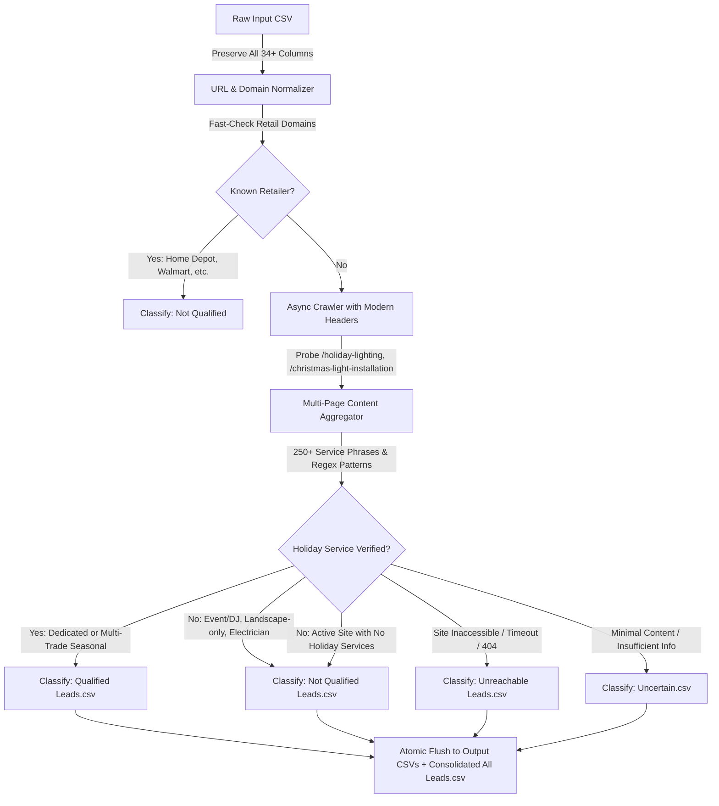

# Production-Grade Contractor Lead Generation & Enrichment Engine

A high-precision, production-grade intelligence and enrichment platform for U.S. service contractors. The system combines state corporate filing ingestion (Florida Sunbiz) with an advanced asynchronous website crawler and multi-signal trade verification engine to discover, crawl, qualify, and segregate genuine contractors while strictly filtering out non-qualifying businesses, retail chains, and directories.

---

## 🌟 Key Features & Capabilities

1. **Christmas & Holiday Lighting Installation Classifier (`classify_christmas_lights.py`)**:
   - Crawls contractor websites and examines seasonal service pages, metadata, and JSON-LD schema.
   - Accurately qualifies genuine holiday lighting installers while preserving seasonal multi-trades (landscapers, window washers, and roofers who offer winter holiday lighting).
   - Strictly excludes event/DJ lighting, landscape-only lighting, general electricians, product retailers, and casual greetings.
   - Automatically segregates leads into 4 dedicated output CSV files.
2. **State Filing Acquisition & Sunbiz Ingestion**:
   - Streams official Florida Department of State (Sunbiz) corporate records directly from public SFTP/HTTPS servers without holding gigabytes in memory.
3. **Zero Commercial API Dependencies**:
   - Operates entirely on direct public state records, public search discovery, and native asynchronous web crawling—no paid API keys, commercial data vendors, or SaaS lock-in.
4. **Resilient Anti-Bot Website Discovery & Crawling**:
   - Uses modern browser fingerprinting (Chrome 131), proactive service endpoint probing, deep 2-tier subpage discovery, and fast-path retail domain exclusion.
5. **Deduplication & Data Integrity**:
   - 100% preservation of all original input columns, data formatting, and multi-line fields, with added diagnostic classification columns and evidence tracking.

---

## 🎄 Christmas & Holiday Lighting Lead Classification Engine

The Christmas lighting pipeline reads raw lead CSVs, crawls company websites, and programmatically determines genuine on-site installation service providers.



### Qualification Rules

| Target Niches (Qualified) | Strict Exclusions (Not Qualified) |
|---|---|
| **Holiday Lighting Installation Companies** | **Landscaping-only / Landscape lighting** (pathway, garden uplighting without holiday service) |
| **Christmas Lighting Installation Companies** | **General electrical contractors** (indoor fixtures, ceiling fans, breaker panels) |
| **Permanent Holiday Lighting Contractors** (Trimlight, Gemstone, Jellyfish, Everlights) | **Event, DJ, wedding, and stage lighting companies** |
| **Seasonal Multi-Trades** (Landscapers, window cleaners, roofers with verified winter holiday lighting) | **Retailers, e-commerce stores, and wholesale lighting suppliers** |
| | **Casual holiday greetings** ("Closed for Christmas", "Holiday hours") with no lighting services |

### Running the Christmas Lighting Classifier

```bash
# Activate virtual environment
.\.venv\Scripts\activate

# Run the classifier using default input (auto-detects the raw CSV in christmas light installation/)
python classify_christmas_lights.py

# Optional: Run with custom concurrency, request timeout, and retries
python classify_christmas_lights.py --concurrency 8 --timeout 20 --retries 3

# Optional: Run a test batch on the first 50 leads
python classify_christmas_lights.py --limit 50

# Optional: Disable resume or customize output folder
python classify_christmas_lights.py --output "christmas light installation/output" --no-resume
```

### Output Files Generated

Outputs are saved inside `christmas light installation/output/<input file name>/` (override with `--output`):

1. **`qualified_leads.csv`**: Confirmed Christmas, holiday, or permanent decorative lighting installation businesses (including seasonal multi-trades).
2. **`not_qualified_leads.csv`**: Businesses whose evaluated website shows unrelated services only (retailers, electricians, event lighting, landscape-only lighting, attractions).
3. **`uncertain_leads.csv`**: Ambiguous or insufficient evidence; needs manual verification.
4. **`unreachable_leads.csv`**: Websites that could not be evaluated after retries (DNS failure, bot challenge, parked domain, robots.txt, persistent timeouts).
5. **`all_leads.csv`**: Every lead with the enrichment columns.
6. **`run_report.json`**: Totals, qualification rate, QA validation results, persistent crawl failures, and uncertain cases.
7. **`crawl_checkpoint.jsonl`**: Incremental per-website results used to resume interrupted runs.

Every file preserves all original input columns and adds:
`Qualification_Status`, `Christmas_Light_Installation`, `Holiday_Light_Installation`, `Permanent_Decorative_Lighting_Installation` (Yes / No / Unclear), `Evidence_URLs`, `Evidence_Summary`, `Service_Keywords_Found`, `Crawl_Status`, `Classification_Confidence`.

Crawling is patient and polite: configurable timeouts, retries with exponential backoff, per-domain request limits, robots.txt respected, sitemap and deep-link discovery, and a second retry pass for temporary failures. Sites behind bot challenges are never bypassed; a Wayback Machine snapshot is evaluated instead when one exists (confidence-discounted, and snapshots older than 4 years are marked Uncertain).

---

## 🏗️ State Filing Ingestion Engine (Florida Sunbiz)

The Florida Sunbiz pipeline ingests official state corporate filings, normalizes business names, classifies primary trade categories, discovers candidate websites, and extracts verified domain-aligned business emails.

```bash
# Run Sunbiz pipeline via the CLI
python -m contractor_scraper.cli.app run --year 2025 --category Roofing --limit 1000
```

---

## 🚀 Installation & Setup

### Prerequisites
- **Python**: Version `3.11`, `3.12`, `3.13`, or `3.14` (64-bit).
- **Git**: Installed on your system.

### 1. Clone & Set Up Virtual Environment

```bash
git clone <REPOSITORY_URL>
cd contractors_finding_scrapper

# Windows (PowerShell)
python -m venv .venv
.\.venv\Scripts\Activate.ps1

# Linux / macOS
python3 -m venv .venv
source .venv/bin/activate
```

### 2. Install Dependencies

```bash
pip install -r requirements.txt
```

---

## 🧪 Testing & Verification

The project includes a comprehensive automated test suite with deterministic mocks covering web crawling, trade classification, subpage extraction, email verification, and CSV enrichment.

```bash
# Run complete test suite (115 tests)
pytest tests/ -v

# Run Christmas lighting enrichment tests specifically
pytest tests/test_christmas_light_enricher_improvements.py -v
```

---

## 📁 Project Directory Structure

```text
contractors_finding_scrapper/
├── classify_christmas_lights.py      # Christmas lighting CLI runner
├── enrich_pest_control.py             # Pest control lead enrichment runner
├── pyproject.toml                     # Project packaging and tool configuration
├── requirements.txt                   # Production dependencies
├── .gitignore                         # Configured ignore patterns
├── christmas light installation/      # Working folder (ignored in git)
│   ├── Christmas Lights Installation...csv  # Raw input leads (5,300+ records)
│   └── output/                        # Categorized CSV output folder
│       ├── Qualified Leads.csv
│       ├── Not Qualified Leads.csv
│       ├── Unreachable Leads.csv
│       ├── Uncertain.csv
│       └── All Leads.csv
├── src/
│   └── contractor_scraper/
│       ├── acquisition/               # Sunbiz SFTP/HTTPS data downloader
│       ├── classification/            # Christmas light & trade classifiers
│       │   ├── christmas_light_classifier.py
│       │   └── classifier.py
│       ├── discovery/                 # Website discovery & crawler
│       │   ├── crawler.py             # Resilient async browser crawler
│       │   └── website_finder.py
│       ├── extraction/                # Business email and contact extraction
│       ├── orchestration/             # Lead enrichment pipeline runners
│       │   ├── christmas_light_enricher.py
│       │   └── lead_engine.py
│       └── storage/                   # SQLite WAL lead database & checkpoints
└── tests/                             # Comprehensive test suite (115 tests)
```

---

## 📄 License

Proprietary & Confidential. Developed for production contractor lead generation and qualification.
