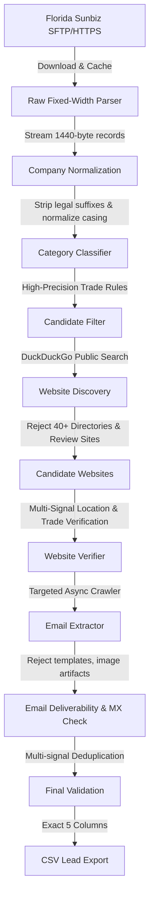

# U.S. Contractor Lead-Generation Engine

A high-accuracy, production-grade lead-generation engine for U.S. contractors. The system ingests official public state corporate filing records (Florida Sunbiz), filters companies through a high-precision multi-signal trade classifier, discovers official company websites via public search without commercial APIs, crawls and verifies business identities, extracts and verifies domain-matched business emails, deduplicates leads, and exports clean CSVs containing strictly verified, complete records.

---

## 1. Project Purpose & Scope

The engine is engineered specifically for lead quality over quantity:

- **Authoritative Initial Dataset**: Florida Department of State (Division of Corporations / Sunbiz) public corporate filing data.
- **Contractor Category Focus**: Modular category system starting with a high-precision **Roofing** contractor classifier, architected to support HVAC, Plumbing, Landscaping, Hardscaping, Remodeling, Pest Control, and Med Spa.
- **Zero Commercial APIs**: Uses official state data portals and public search engine indices—no paid API keys, commercial data vendors, or SaaS dependencies.
- **Strict 5-Column Lead Requirement**: Every output lead in the final CSV strictly contains all five fields:
  ```text
  Company Name,Email,Website,City,State
  ```
- **Zero Placeholders**: If any field is missing, invalid, or fails identity verification, the record is excluded. No `N/A`, `Unknown`, `None`, or blanks are ever output.

---

## 2. Core Architecture & Pipeline



### Pipeline Stages
1. **Sunbiz Acquisition Layer** ([`FloridaSunbizSource`](file:///d:/Production%20Grade/contractors_finding_scrapper/src/contractor_scraper/acquisition/sunbiz.py)): Connects directly to Florida DOS public SFTP/HTTPS server (`https://sftp.floridados.gov/Public/doc/cor/`), discovers daily filing datasets for the requested year (e.g. 2025), caches raw files locally in `data/raw/sunbiz/<year>/`, and streams lines without holding gigabytes in memory.
2. **Fixed-Width Record Parser** ([`SunbizRecordParser`](file:///d:/Production%20Grade/contractors_finding_scrapper/src/contractor_scraper/parsing/sunbiz_parser.py)): Streams 1440-byte fixed-width ASCII lines, extracting filing numbers, corporate names, status, physical addresses, cities, states, zip codes, and filing dates.
3. **Normalization Engine** ([`clean_company_name`](file:///d:/Production%20Grade/contractors_finding_scrapper/src/contractor_scraper/normalization/cleaners.py)): Strips legal suffixes (`LLC`, `INC`, `CORP`, `P.A.`, etc.), normalizes casing to clean Title Case while preserving trade acronyms (`HVAC`, `AC`, `USA`), and cleans cities and 2-letter state codes while keeping raw names preserved.
4. **Category Classifier** ([`RoofingClassifier`](file:///d:/Production%20Grade/contractors_finding_scrapper/src/contractor_scraper/classification/classifier.py)): High-precision scoring evaluating strong positive contractor phrases, supporting trade terms, negative exclusion lists (wholesale, supplies, materials, manufacturing, software, consulting, hospitality), and false-positive regex ("red roof", "tin roof restaurant", etc.).
5. **Website Discovery** ([`WebsiteFinder`](file:///d:/Production%20Grade/contractors_finding_scrapper/src/contractor_scraper/discovery/website_finder.py)): Queries public search indices with high-intent query permutations (`"{Company}" {City} FL`, `"{Company}" roofing {City} FL`), unquotes redirects, extracts root domains, and strictly filters 40+ directories and lead portals (Yelp, BBB, Angi, HomeAdvisor, Thumbtack, YellowPages, Cortera, etc.). Results are deterministically cached to disk.
6. **Website Crawler & Verifier** ([`WebsiteCrawler`](file:///d:/Production%20Grade/contractors_finding_scrapper/src/contractor_scraper/discovery/crawler.py), [`WebsiteVerifier`](file:///d:/Production%20Grade/contractors_finding_scrapper/src/contractor_scraper/discovery/website_verifier.py)): Crawls homepage and targeted `/contact` and `/about` subpages. Computes multi-signal confidence scores across business name tokens, Florida/city geographic signals, contractor trade keywords, and domain name relevance (threshold >= 0.70).
7. **Email Extraction & Verification** ([`EmailExtractor`](file:///d:/Production%20Grade/contractors_finding_scrapper/src/contractor_scraper/extraction/email_extractor.py), [`EmailVerifier`](file:///d:/Production%20Grade/contractors_finding_scrapper/src/contractor_scraper/extraction/email_verifier.py)): Extracts `mailto:` and body text emails, filters dummy templates (`test@`, `example@`, `admin@`, `noreply@`), ignores image artifacts (`icon.png@...`), scores domain-aligned mail addresses, and verifies active DNS MX/A mail exchange records.
8. **Deduplication** ([`LeadDeduplicator`](file:///d:/Production%20Grade/contractors_finding_scrapper/src/contractor_scraper/matching/dedup.py)): Tracks canonical company fingerprints, website domains, and emails to prevent duplicate entries in output leads.
9. **Lead Engine Orchestration** ([`LeadEngine`](file:///d:/Production%20Grade/contractors_finding_scrapper/src/contractor_scraper/orchestration/lead_engine.py)): Manages async concurrency limits, checkpoints runs in SQLite WAL database, stops ingestion immediately once the target limit of verified leads is satisfied, and outputs the clean CSV.

---

## 3. Installation & Quick Setup

Follow these simple steps to clone, set up, and run the project locally.

### Prerequisites
- **Python**: Version `3.11`, `3.12`, `3.13`, or `3.14` (64-bit).
- **Git**: Installed on your system.

---

### Step 1: Clone the Repository
```bash
git clone <GITHUB_REPO_URL>
cd contractors_finding_scrapper
```

---

### Step 2: Create & Activate a Virtual Environment

**Windows (PowerShell):**
```powershell
python -m venv .venv
.\.venv\Scripts\Activate.ps1
```
*(If you see a script execution policy restriction in PowerShell, run `Set-ExecutionPolicy -Scope Process -ExecutionPolicy Bypass` and retry.)*

**Windows (Command Prompt):**
```cmd
python -m venv .venv
.\.venv\Scripts\activate.bat
```

**Linux / macOS:**
```bash
python3 -m venv .venv
source .venv/bin/activate
```

---

### Step 3: Install Dependencies

You can install using `requirements.txt` or editable package install:

```bash
# Option A: Install via requirements.txt
pip install -r requirements.txt

# Option B: Install package in editable mode
pip install -e .

# Optional: Install developer tools (pytest, ruff)
pip install -e ".[dev]"
```

---

### Step 4: Environment Variables & Configuration (.env)

> **Good News**: The project works **100% out of the box** without any paid API keys or commercial services. It uses official public state records and public search indexing.

If you wish to customize default settings (concurrency, output directories, log level):

**Windows (PowerShell / CMD):**
```bash
copy .env.example .env
```

**Linux / macOS:**
```bash
cp .env.example .env
```

Key optional settings inside `.env`:
- `SCRAPER_SELECTED_CATEGORY`: Default category (e.g. `Roofing`, `HVAC`, `Plumbing`)
- `SCRAPER_SELECTED_STATE`: Default 2-letter state code (`TX`, `FL`, `CA`, etc.)
- `SCRAPER_CONCURRENCY_LIMIT`: Max concurrent async workers (default `10`)
- `SCRAPER_LOG_LEVEL`: Log level (`INFO`, `DEBUG`)

---

### Step 5: Initialize the Database

Initialize persistent SQLite tables and local directories:

```bash
python scraper.py init-db
```

Verify your setup status anytime:
```bash
python scraper.py status
```

---

## 4. CLI Usage

The primary command line interface is `contractor-scraper`.

### Running the Lead Engine

```bash
# 1. Generate verified roofing contractor leads for year 2025 (target limit: 10,000)
python scraper.py --year 2025 --keyword roofing --limit 10000

# 2. Target 2024 HVAC contractors with limit 5,000
python scraper.py --year 2024 --keyword hvac --limit 5000

# 3. Target 2025 Plumbing contractors with limit 2,500
python scraper.py --year 2025 --keyword plumbing --limit 2500

# 4. Sampling / Testing run on 1 Sunbiz filing file
python scraper.py --year 2025 --keyword roofing --limit 10 --max-files 1
```

All commands can also be run via the CLI script:
```bash
contractor-scraper --year 2025 --keyword roofing --limit 10000
```

### Supported Categories & Keyword Aliases
- `roofing` (aliases: `roof`, `roofer`, `roofers`)
- `hvac` (aliases: `ac`, `air-conditioning`, `heating`, `cooling`)
- `plumbing` (aliases: `plumber`, `plumbers`)
- `landscaping` (aliases: `lawn`, `landscape`)
- `hardscaping` (aliases: `hardscape`, `paver`, `pavers`)
- `remodeling` (aliases: `remodel`, `remodeler`, `renovation`)
- `pest-control` (aliases: `pest`, `exterminator`)
- `med-spa` (aliases: `medspa`, `medical-spa`)

### Additional CLI Commands
- `python scraper.py --help`: Display CLI options and usage.
- `python scraper.py status`: Inspect configuration, concurrency limits, and data paths.
- `python scraper.py init-db`: Initialize or verify persistent SQLite tables.
- `python scraper.py inspect-runs`: Display recent execution checkpoints, records processed, and lead counts.

---

## 5. Output Format

Every execution automatically generates **two separate CSV files** in the `data/output/` directory:

1. **Production-Ready Leads** (`data/output/production_leads.csv` & `data/output/<category>_<year>_production_leads.csv`):
   Contains highest-quality verified leads where both the official company website and email contact are present.
2. **Leads Missing Email or Website** (`data/output/leads_missing_contact.csv` & `data/output/<category>_<year>_leads_missing_contact.csv`):
   Contains verified trade contractor matches from the official state filing data where the email address and/or website could not yet be discovered, allowing you to research them later without losing valid leads.

### Output Column Schema (Identical across both files)
```csv
Company Name,Website,Email,City,State,Formation Date,Document Number,Company Status,Street Address,ZIP Code,Industry
```

#### Example: `production_leads.csv`
```csv
Company Name,Website,Email,City,State,Formation Date,Document Number,Company Status,Street Address,ZIP Code,Industry
Apex Roofing LLC,https://apexroofingfl.com,info@apexroofingfl.com,Orlando,FL,2025-01-02,P25000001234,Active,123 Main St,32801,Roofing
Summit Roof Repairs,https://summitroofs.com,contact@summitroofs.com,Tampa,FL,2025-01-03,P25000001235,Active,456 Oak Ave,33602,Roofing
```

#### Example: `leads_missing_contact.csv`
```csv
Company Name,Website,Email,City,State,Formation Date,Document Number,Company Status,Street Address,ZIP Code,Industry
Coastal Roofing Pros,https://coastalroofingpros.com,,Jacksonville,FL,2025-01-04,P25000001236,Active,789 Bay St,32202,Roofing
Sunshine State Roofing,,,Miami,FL,2025-01-05,P25000001237,Active,101 Palm Ave,33101,Roofing
```

* **Strict Industry Matching**: Unrelated businesses (e.g. financial firms, hardware retail stores, supplier wholesalers) are strictly excluded from both CSV files.
* **Zero Fake Placeholders**: Missing values are left blank—no placeholders such as `N/A`, `Unknown`, or `None` are used.

---

## 6. Execution Telemetry & Summary

At the completion of each run, a comprehensive telemetry audit is displayed:

```text
+------------------------- Lead Generation Execution Summary -------------------------+
| Year:                  2025                                                         |
| Category:              Roofing                                                      |
| Requested Limit:       10,000                                                       |
| Raw Records Examined:  250,000                                                      |
| Category Candidates:   18,420                                                       |
| Websites Discovered:   15,700                                                       |
| Websites Verified:     11,240                                                       |
| Emails Discovered:     8,913                                                        |
| Final Complete Leads:  8,421                                                        |
| Rejected Records:      9,999                                                        |
| Duration:              1240.5s                                                      |
| Output File:           data\output\roofing_2025.csv                                 |
+-------------------------------------------------------------------------------------+
```

---

## 7. Testing & Quality Assurance

The project includes an automated test suite with deterministic mocks covering Sunbiz parsing, company normalization, category classification, website discovery, website verification, email extraction, DNS verification, deduplication, and end-to-end engine limit behavior.

```bash
# Run pytest test suite (67 tests)
pytest -v

# Run linter
ruff check .

# Run code format checker
ruff format --check .
```

---

## 8. Publishing & Pushing to GitHub

To upload this repository to GitHub for the first time:

```bash
# 1. Initialize local Git repository
git init

# 2. Stage all project files (ignoring files listed in .gitignore)
git add .

# 3. Create initial commit
git commit -m "Initial commit: U.S. Contractor Lead-Generation Engine"

# 4. Set main branch
git branch -M main

# 5. Link to your GitHub repository
git remote add origin https://github.com/<YOUR_USERNAME>/<YOUR_REPOSITORY>.git

# 6. Push code to GitHub
git push -u origin main
```

